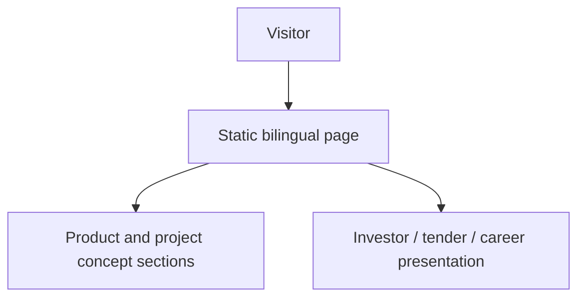

# KIMA — Website Redesign Concept

An independent bilingual redesign concept for Egyptian Chemical Industries (KIMA). This is a portfolio demonstration only, not an official KIMA website.

> **Non-affiliation notice:** This unsolicited concept is not affiliated with, approved by, or endorsed by KIMA, CIHC, or any related entity. Company names, trademarks, and third-party material remain the property of their respective owners.

## Problem and concept

The page explores a structured bilingual presentation for industrial products, expansion projects, company information, investor relations, tenders, careers, and contact details.

## Repository contents

- `index.html` — static Arabic/English concept page.
- `flag.jpg` — visual asset used by the page.

The current project is a static presentation. It has no connection to manufacturing systems, product catalog APIs, financial disclosures, procurement, careers, or internal company data.

## Architecture

No backend, authentication, CMS, or live data source is included.

## Quick start

Open `index.html` in a modern browser. No dependencies or build command are required.

## Accuracy and permissions

Product specifications, standards, production information, ownership percentages, project details, company history, contacts, and financial claims must be verified against current official sources before external presentation. Treat the current page as concept content, not an official disclosure. Do not use company logos or imply endorsement without written permission.

## Proof of Concept & Enterprise Customization Readiness

**Status: Static unsolicited concept — not an official corporate platform.**

- [x] Bilingual static presentation.
- [ ] Verify all figures, standards, ownership, and corporate facts.
- [ ] Confirm image and asset permissions.
- [ ] Add accessibility and responsive-browser checks.
- [ ] Obtain written approval before official branding or integrations.

## Change log

- 2026-11-28 — Added project scope, usage, architecture, and non-affiliation notice.

## Intellectual Property & Authorship

Concept and original implementation attribution: **Aly Hussein Zopair (علي حسين زبير ALY HUSSEIN ZOPAIR)**. No software license is granted by this README. Third-party marks and materials remain with their respective owners.
